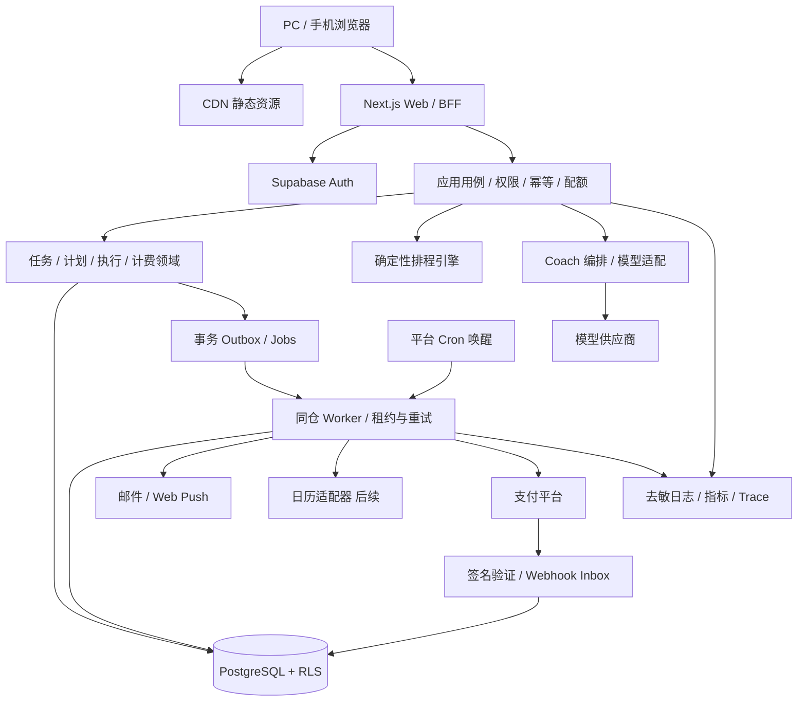

# 技术架构与决策

[索引](README.md) · [数据](04-database.md) · [AI](05-ai-coach.md) · [质量](11-quality-operations.md)

## 选型结论

| 方案 | 开发/维护与成本 | 稳定性、安全、扩展 | 决策 |
|---|---|---|---|
| Next.js 全栈模块化单体 | 一套 TS，SEO 与应用共存，适合小团队；需理解缓存和服务器边界 | 领域逻辑不能散落 Server Actions；用户页面不共享缓存 | 采用 |
| React SPA + Fastify | API 边界清晰，但双部署和鉴权链路增加工作 | 将来多客户端更自然 | 团队已有后端能力或原生端成为重点时再拆 |
| Django/Rails | CRUD、管理后台成熟 | Python/Ruby 与 TS 双语言；不是技术上较差 | 若团队熟悉可替代，不为 AI 理由强行用 TS |
| PostgreSQL + Supabase | 托管认证、存储降低运维；RLS 仍需自行验证 | 可迁出 PG，Auth/Realtime 有适配成本 | 采用托管 PG/Auth；不把业务规则写进供应商专有接口 |
| 自建 PostgreSQL/Auth | 基础设施账单可能低，值班与恢复成本高 | 补丁、备份、邮件和登录安全由团队承担 | 早期反对 |
| Tailwind + shadcn/ui | 快速统一组件，但复制进项目的组件需自维护 | 无障碍不能假设自动满足 | 采用，限制设计 token 与组件变体 |
| Redis/Kafka/微服务 | 初期增加部署、故障与事务协调成本 | 暂无规模依据 | 不采用；PG outbox + jobs 足够 |
| 独立 Python/OR-Tools 调度服务 | 复杂优化有优势，增加语言与运维 | 等约束复杂度和实测收益支持再引入 | 第一版确定性 TS 启发式 |

Next.js、React 和依赖在实施时选择当时受支持稳定版本、锁定 lockfile，不在方案中虚构最新版本。单体包含可分离模块，worker 是同仓同领域代码的后台入口，不是独立业务微服务。

## 系统与部署图



生产采用单一区域 Next.js 托管 + 同区域 Supabase + 小型容器 worker；预览环境独立数据库，不接生产支付密钥。若预算优先，可将 Next.js 与 worker 放同一托管容器平台，但必须独立进程、健康检查和重启策略。生产用付费基础层，不能把免费层视为 SLA。[Supabase 价格](https://supabase.com/pricing)、[Vercel 价格](https://vercel.com/pricing)仅用于实施时核算，不承诺包含所有用量。

## 前后端边界与目录

```text
src/app/(marketing)/             Landing、定价、条款
src/app/(auth)/                  登录、回调、找回
src/app/(workspace)/             今日、任务、目标、复盘、设置
src/app/api/v1/                  HTTP 适配，无领域规则
src/modules/{tasks,planning,execution,coach,billing}/
  domain/ application/ infrastructure/ ui/
src/lib/{auth,db,observability,time}/
src/components/ui/               基础组件与可访问性
workers/                        jobs、通知、额度对账
prompts/                        版本化模板和评测集
supabase/migrations/            审核过的 SQL
tests/{unit,integration,e2e,security,load}/
```

RSC 负责首屏读取；日历、计时器、编辑表单为 Client Component；服务端校验所有输入，客户端校验仅改善体验。服务器状态使用单一查询缓存，避免页面本地状态复制整套任务。拖动只产生预览命令；写成功后失效缓存。移动端优先列表，日历不是唯一操作入口。

API：`POST /tasks`、`PATCH /tasks/:id` 带 expectedVersion；`POST /plans/preview`、`POST /plans/:id/commit`；`POST /execution/events`；`POST /coach/proposals`、`POST /coach/proposals/:id/approve`；`POST /billing/checkout`；`POST /webhooks/payment`。每个 mutation 接收 Idempotency-Key；冲突返回 409 和最新版本，权限错误不暴露其他用户对象是否存在。

业务写事务：核验身份/权益 → 锁定必要行 → 校验版本及约束 → 更新事实与历史 → 写 outbox → 提交。外部 API 调用不放数据库事务内。用户读使用 JWT 对应 RLS；后端写使用最小权限角色和显式 actor 上下文，不能常态用 service_role 绕过隔离。AI adapter 无任何数据库访问凭据。

## 后台任务与外部集成

Cron 只唤醒，不保证准点投递。jobs 用 `FOR UPDATE SKIP LOCKED` 领取、租约超时重领；指数退避加随机抖动，最多 5 次后死信。业务副作用用幂等键，承认至少一次投递。提醒发送前重新核验任务、免打扰、时区与额度，过时提醒丢弃。

支付：签名原文校验、事件唯一键、持久化 inbox 后应答、异步处理、每日对账；不能靠 checkout 成功跳转授予 Pro。[Stripe webhook 文档](https://docs.stripe.com/webhooks)是重复/乱序处理的实施依据。

日历：先读忙闲；授权最小 scope，refresh token 加密进私有 schema，断连立即停止同步。游标失效全量重建，外部 ID 唯一、删除墓碑、版本/etag 校验；同步状态显示“最近更新”。过期数据时警告计划可能冲突。外部双向写后续用 saga 补偿，无法假装跨平台原子事务。

扩展条件：当 worker 持续积压且加实例无法缓解，才引入独立队列；当跨服务部署有明确组织收益才拆服务；向量检索须以检索评测优于关系查询为前提。
