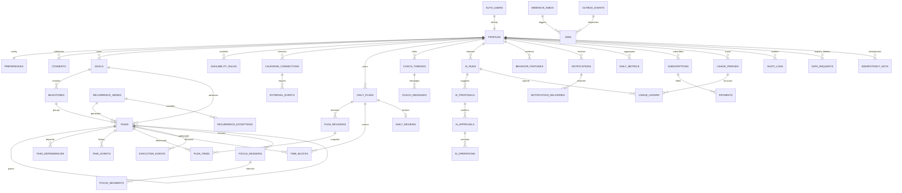

# 数据库设计与 ER

[索引](README.md) · [SQL 草案](sql/001-core-draft.sql) · [排程](06-scheduling.md)

## 设计约定

无原数据库可检查；此为完整逻辑目标模型，按路线图分期迁移。不是一次上线全部表。默认字段：`id uuid PK default gen_random_uuid()`、`user_id uuid NOT NULL FK profiles(id)`、`created_at timestamptz NOT NULL default now()`。可变业务表另含 `updated_at timestamptz NOT NULL`、`version bigint NOT NULL default 1 CHECK(version>0)`；默认每个字段 NOT NULL，下面 `?` 表示 nullable。金额用最小货币单位 bigint；不使用 float。时间间隔以整数分钟，精确执行秒数用整数；UTC 时间点用 timestamptz。

所有用户内关系用 `(user_id, referenced_id)` → `(user_id,id)` 复合外键，引用端加索引，防止合法自身行引用其他用户对象。被引用表均 `UNIQUE(user_id,id)`。外键默认 RESTRICT；删除用户由删除作业按依赖顺序执行，支付法定保留数据按地区规则最小化/去标识。不可变事件不允许客户端改写。枚举使用 text + CHECK，便于可控扩展。

## ER 图（字段见后表）

用户归属边为避免拥挤仅画部分；所有业务表的 user_id 约束仍适用。auth.users 是托管认证表，不自建密码表。系统级 inbox/jobs/outbox 的 user_id 可空，但不暴露给用户 Data API。

## 字段字典、约束与索引

| 表 | 专有字段（除公共字段） | 约束/索引 |
|---|---|---|
| profiles | id 同 auth.users.id；display_name text；timezone text；locale text；status text | FK auth.users；timezone 经 IANA 白名单校验；status active/deleting/disabled |
| preferences | user_id PK；workday_start time；quiet_start/quiet_end time；coach_enabled bool；push_enabled bool；daily_nudge_limit smallint；planning_load numeric(3,2) | load 0.3–0.9；提醒 0–10；不另设无用 id |
| consents | purpose text；policy_version text；granted_at timestamptz；revoked_at timestamptz?；scope jsonb | (user_id,purpose,granted_at DESC)；记录历史，撤销非删除 |
| goals | title text；success_criteria text；target_date date?；status text | active/paused/completed/archived；(user_id,status) |
| milestones | goal_id uuid；title text；acceptance text；target_date date?；position int；status text | 同用户 goal FK；(user_id,goal_id,position) |
| tasks | goal_id uuid?；milestone_id uuid?；parent_id uuid?；series_id uuid?；occurrence_key text?；title text；description text；status text；priority smallint；estimate_minutes int?；remaining_minutes int?；splittable bool；min_chunk_minutes int；earliest_at timestamptz?；due_at timestamptz?；due_date date?；due_timezone text?；deadline_kind text；completed_at timestamptz?；deleted_at timestamptz? | priority 0–3；时长非负，estimate >0；日期与时间截止互斥；(user_id,status,due_at) partial 未删除；UNIQUE(user_id,series_id,occurrence_key) |
| task_dependencies | task_id uuid；predecessor_id uuid | 同用户双 FK；UNIQUE(user_id,task_id,predecessor_id)；禁止自身；事务内 DAG 检查 |
| task_events | task_id uuid；event_type text；before_data jsonb；after_data jsonb；actor_type text；command_id uuid | (user_id,task_id,created_at,id)；仅追加；敏感正文保留期受限 |
| recurrence_series | template jsonb；rrule text；timezone text；dtstart_local timestamp；generation_until date；active bool | 有界 RRULE 验证；(user_id,active,generation_until) |
| recurrence_exceptions | series_id uuid；occurrence_key text；kind text；override_data jsonb? | UNIQUE(user_id,series_id,occurrence_key)；skip/override；禁止删除历史实例 |
| availability_rules | weekday smallint；local_start/local_end time；timezone text；valid_from date；valid_to date? | weekday 0–6；跨午夜拆两条；(user_id,weekday,valid_from) |
| calendar_connections | provider text；external_account_id text；token_secret_ref text；scope text[]；sync_cursor text?；last_synced_at timestamptz?；status text | UNIQUE(user_id,provider,external_account_id)；token 本体在私有加密存储 |
| external_events | connection_id uuid；external_id text；etag text?；start_at/end_at timestamptz?；all_day_start/all_day_end date?；timezone text；busy bool；deleted_at timestamptz? | 唯一(connection_id,external_id)；全日或时间区间二选一；结束排他；(user_id,start_at,end_at) |
| daily_plans | local_date date；timezone text；capacity_minutes int；load_factor numeric(3,2)；current_revision int；status text | UNIQUE(user_id,local_date)；版本修改锁；时区冻结 |
| plan_revisions | plan_id uuid；revision int；input_hash text；algorithm_version text；cause text；snapshot jsonb | UNIQUE(user_id,plan_id,revision)；不可变，保存原始承诺 |
| plan_items | revision_id uuid；task_id uuid；planned_minutes int；rank int；commitment text | UNIQUE(user_id,revision_id,task_id)；must/optional；历史不随任务删除而丢失 |
| time_blocks | plan_id uuid；task_id uuid?；kind text；start_at/end_at timestamptz；locked bool；state text；buffer_minutes int | task/fixed/break；active/cancelled/completed；有效区间排他约束；(user_id,plan_id,start_at) |
| execution_events | task_id uuid；session_id uuid?；event_type text；occurred_at timestamptz；recorded_at timestamptz；source text；client_event_id uuid；payload jsonb | UNIQUE(user_id,client_event_id)；(user_id,task_id,occurred_at)；补记与同步时间分开 |
| focus_sessions | task_id uuid；state text；started_at timestamptz；ended_at timestamptz?；last_heartbeat_at timestamptz? | partial UNIQUE(user_id) WHERE state in running/paused；不能后台自动认定持续工作 |
| focus_segments | session_id uuid；start_at/end_at timestamptz?；confidence text | 每会话至多一个开放段；非重叠；暂停关闭段，恢复开新段 |
| daily_reviews | plan_id uuid；summary text；obstacle text?；self_rating smallint? | UNIQUE(user_id,plan_id)；rating 1–5；可跳过 |
| coach_threads | title text；goal_id uuid?；archived_at timestamptz? | (user_id,updated_at DESC) |
| coach_messages | thread_id uuid；role text；content text；run_id uuid? | role user/assistant；(user_id,thread_id,created_at,id)；禁止客户端伪造系统角色 |
| ai_runs | request_key text；model text；prompt_version text；status text；input_tokens/output_tokens int；cost_microusd bigint；error_code text? | UNIQUE(user_id,request_key)；token/cost ≥0；(user_id,created_at) |
| ai_proposals | run_id uuid；schema_version int；operations jsonb；evidence_refs jsonb；operation_hash text；expires_at timestamptz；status text | draft/ready/approved/executed/rejected/expired/failed；(user_id,status,expires_at) |
| ai_approvals | proposal_id uuid；operation_hash text；approved_at timestamptz；expires_at timestamptz；revoked_at timestamptz? | UNIQUE(user_id,proposal_id,operation_hash)；确认身份服务器填写 |
| ai_operations | approval_id uuid；operation_index int；idempotency_key text；before_data/after_data jsonb；status text；error_code text? | UNIQUE(user_id,idempotency_key)；(user_id,approval_id,operation_index) |
| behavior_features | feature_key text；window_start/window_end date；sample_count int；value jsonb；evidence_refs jsonb；algorithm_version text | UNIQUE(user_id,feature_key,window_end,algorithm_version)；可重建，禁止作为事实源 |
| notifications | kind text；payload jsonb；dedupe_key text；scheduled_at timestamptz；read_at timestamptz?；status text | UNIQUE(user_id,dedupe_key)；(user_id,read_at,created_at DESC) |
| notification_deliveries | notification_id uuid；channel text；provider_id text?；attempts int；status text；sent_at timestamptz? | UNIQUE(user_id,notification_id,channel)；发送状态不等于阅读 |
| daily_metrics | local_date date；timezone text；metrics jsonb；source_watermark timestamptz；algorithm_version text | UNIQUE(user_id,local_date,algorithm_version)；可重算，按原计划分母统计 |
| subscriptions | provider text；external_subscription_id text；plan_code text；status text；period_start/end timestamptz；cancel_at_period_end bool；provider_updated_at timestamptz | UNIQUE(provider,external_subscription_id)；(user_id,status)；支付快照非客户端可改 |
| payments | subscription_id uuid?；provider text；external_payment_id text；amount_minor bigint；currency char(3)；kind text；status text；parent_payment_id uuid? | UNIQUE(provider,external_payment_id,kind)；charge/refund；退款新行、不覆盖原账 |
| usage_periods | period_start/end timestamptz；grant_units bigint；reserved_units bigint；spent_units bigint | UNIQUE(user_id,period_start,period_end)；非负且 reserved+spent≤grant；账户行锁 |
| usage_ledger | period_id uuid；run_id uuid?；entry_type text；units bigint；dedupe_key text | reserve/settle/release/grant/adjust；UNIQUE(user_id,dedupe_key)；不可变；期末对账 |
| audit_logs | actor_id uuid?；action text；object_type text；object_id uuid?；request_id text；metadata jsonb | (user_id,created_at DESC)；追加、去敏；不能记录密钥或完整 prompt |
| data_requests | kind text；status text；requested_at timestamptz；completed_at timestamptz?；artifact_key text?；expires_at timestamptz? | export/delete；(user_id,status)；导出对象短时签名下载 |
| idempotency_keys | scope text；key text；request_hash text；response_code int?；response_ref jsonb?；expires_at timestamptz | UNIQUE(user_id,scope,key)；相同键不同请求拒绝 |
| webhook_inbox | provider text；external_event_id text；payload jsonb；status text；received_at timestamptz；processed_at timestamptz? | 系统表；UNIQUE(provider,external_event_id)；payload 最小化/保留期 |
| outbox_events | aggregate_type text；aggregate_id uuid；event_type text；payload jsonb；published_at timestamptz? | (created_at) WHERE published_at IS NULL；与业务同事务写 |
| jobs | job_type text；payload jsonb；dedupe_key text；run_at timestamptz；lease_until timestamptz?；attempts int；status text；last_error text? | UNIQUE(dedupe_key)；(status,run_at)；私有 schema |

索引原则：所有 FK 的引用列要有前缀匹配索引；已有复合唯一索引可覆盖则不重复建。全局唯一 provider ID 仅系统使用。大 JSON 不默认建 GIN，先看真实查询。核心业务字段不用 JSON 隐藏；仅建议 payload、配置快照和派生统计允许 JSON，并有版本化 schema。

## 一致性与时间语义

任务状态 todo/in_progress/blocked/done/cancelled；延期是计划变化不是任务状态。父任务仅汇总，不排程；仅叶子任务排程。目标/里程碑与任务组合归属由用例事务校验，防同用户内误挂错误目标。任务层级/依赖用用户级事务锁防并发成环。完成事件、状态与历史同事务提交；重开任务追加事件，不抹去历史。

重复任务用 RRULE 系列 + 实例唯一 occurrence_key；key 是原始当地发生时间及 DST fold 标识，改期不改 key。未来 30 天滚动生成；每次最多 1000 实例。支持“仅本次/此次及以后（拆系列）/整系列未来”，不重写已完成实例。MVP 只开放每日/每周，月底规则和完成后间隔重复后续再做。

时区用 IANA 名称。日计划保存生成时 timezone；出差只影响未来未确认计划，历史当地日期不重算。当地日期边界由时区库转换为 UTC，天可能是 23/25 小时。春季不存在的重复时间默认移到下一个有效时间并标注；秋季重复时间默认较早 offset，用户可选；固定外部事件保留真实 instant。截止只有日期时按指定时区次日 00:00 排他上界，不能硬编码 23:59:59。

多设备 mutation 必须 expectedVersion + 幂等键；过期版本 409，禁止静默 last-write-wins。Realtime 只是缓存失效提示，断线重连按服务器快照/增量游标补读。第一版不承诺离线写；短网断表单可本地暂存并显示“未同步”，禁止假成功。

RLS 所有用户表 ENABLE/FORCE，SELECT 使用 auth.uid() = user_id，写入同时 USING/WITH CHECK；但权益、支付、审批、审计、AI 操作和统计只允许服务器写。表隔离不能替代列权限/状态机。service_role 绕过 RLS，限隔离 worker/受审计运维；更优是受限后台角色及白名单存储过程。[官方 RLS 文档](https://supabase.com/docs/guides/database/postgres/row-level-security)。

## 迁移计划

001 profiles/goals/tasks/constraints；002 plans/time/execution/history；003 recurrence；004 coach/approval/quota；005 billing/inbox；006 notifications/jobs/audit；007 integrations/derived metrics。每次先可兼容新增 → 有界回填 → 双版本兼容 → 收紧约束 → 延后清理旧字段。大索引 CONCURRENTLY 独立执行，NOT VALID 外键验证后再切换。生产回退优先回退应用，破坏性 DDL 必须恢复演练。

导出覆盖用户配置、目标、所有任务/实例、计划版本、执行事件、对话、建议和订阅记录，以 JSON+CSV 和 schemaVersion 打包。删除先注销会话和外部授权、停 jobs，再清理业务和存储，保留最小合法账务。备份中的数据随保留期到期；恢复时必须重放删除清单，防数据复活。
