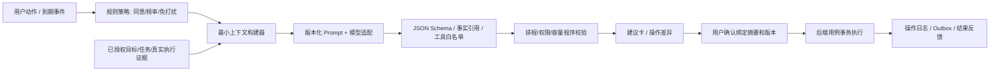

# AI Coach 技术设计

[索引](README.md) · [数据](04-database.md) · [调度](06-scheduling.md)

## 架构与数据流



LLM 负责澄清、语言理解、候选拆解和解释；程序负责日期换算、可行性、权限、状态、额度与执行。第一版一个有界编排器即可，多 Agent 会增加成本和不确定性，没有已证实收益。

上下文包：用户声明的目标/偏好、未来 7 日可用时间摘要、相关未完成任务、最近 14 日执行聚合、当前障碍、证据 ID 与时间窗。默认不读取其他目标聊天，不发送邮箱、支付信息、OAuth token。任务正文属于不可信数据，不能提升为系统指令。

## 目标拆解示例

输入“两个月内学会 Python，并完成 Web 项目”时先问基础、每周时间、项目范围与验收。假设零基础、每周 6 小时、8 周约 48 小时，保留 20% 缓冲后只有约 38 小时可计划；“学会”改为可运行、可部署的小型 CRUD 项目，不承诺专业熟练。

候选里程碑：第 1–2 周基础语法/小脚本（8h）；第 3 周 HTTP、框架和路由（5h）；第 4–5 周 CRUD/数据库（10h）；第 6 周界面与验证（5h）；第 7 周测试部署（6h）；第 8 周演示和修复（4h）。若用户只有每周 2 小时，建议减少项目范围或延长时间。

只详细展开未来 7 天，其余保留粗粒度，避免一次生成上百个不可维护任务。第一天建议“安装环境并运行 hello.py，30 分钟”，提供完成判据。所有估时标注为假设，用户可改；确认后一次事务创建目标、里程碑和任务；排程引擎另行生成每日计划。

## 主动指导策略

| 事件 | 可靠触发依据 | 行为 |
|---|---|---|
| 开始一天 | 本地日首次打开、无已确认计划 | 站内容量建议，不默认推送 |
| 尚未开始 | 时间块开始 15 分钟后无开始记录 | 询问“已开始/缩小一步/稍后”；不能断言拖延 |
| 超时 | 活跃会话超过估计时长，最近仍有交互 | 询问继续、补估或暂停，不自动完成 |
| 用户受阻 | 用户主动提交障碍 | 提供最多 3 个行动，优先一个 5–15 分钟步骤 |
| 完成 | 确认完成事件 | 简短事实反馈，不每次调用模型 |
| 日终 | 用户选定时间且已有执行记录 | 可跳过的复盘，先规则统计再生成解释 |

默认主动提醒 ≤2/本地日，间隔 ≥120 分钟，免打扰 22:00–08:00 可调整。事务提醒与教练提醒分开开关；跨设备共享频控、唯一事件键。拒绝后同类建议冷却 24h；连续 3 次忽略降低频率。用户主动求助不受主动通知上限，但仍受 AI 用量控制。Web Push 不保证后台准时；权限拒绝保留站内消息。

## 工具与授权协议

只读工具：`get_task_context`、`get_capacity`、`preview_schedule`；均由服务器注入 user_id 并限定对象范围。建议工具：`propose_task_breakdown`、`propose_plan_change`；只能写建议表。执行工具只接受已确认 proposal ID，模型不能直接调用通用 SQL、任意 URL 或 shell。

```json
{
  "schemaVersion": 1,
  "proposalId": "uuid",
  "operations": [{"type":"reschedule_block","blockId":"uuid","expectedVersion":3,"startAt":"2026-11-19T01:00:00Z","endAt":"2026-11-19T01:30:00Z"}],
  "evidenceIds": ["event-uuid"],
  "reason": "可用时间减少",
  "expiresAt": "2026-11-18T10:10:00Z"
}
```

确认 UI 展示所有变更和影响；服务端存规范化操作 hash、用户、版本、权限范围、10 分钟有效期。审批请求必须有真实会话，CSRF/Origin 防护；审批不是聊天中的“好”字自动授权。执行时重查所有权、任务版本、时间冲突、订阅能力；任一失效整体拒绝并重做预览。创建、改期、批量修改均需确认；删除、改截止日期、外部写入额外明确提示。订阅购买/取消、账户删除不对模型开放。

数据库变更失败原子回滚；成功后的撤销是条件逆向操作，要求对象没有被后续修改。外部操作使用补偿流程和逐项结果，不能承诺完全回滚。授权撤销或过期后 worker 执行前再次校验。proposal、approval、execution 按唯一键防双击及重试重复执行。

## 注入防护、画像和评测

Prompt 不能承担安全边界。系统策略与用户数据分区；外部任务标题、网页、日历内容均为数据；禁止按其指令扩大 scope。模型输出经枚举白名单、长度限制、JSON 校验、所有权校验和安全渲染；链接不自动抓取，后续若引入需 SSRF 防护。测试跨用户 ID、伪系统指令、泄露 token、绕过确认和超额循环。

画像从聚合事实产生：时段完成样本数、类别开始延迟、实际/估计时长中位比、不同提醒接受与后续开始率。每项保存时间窗、样本量、置信度、算法版本和来源；不足 10 个可比样本不提供个性化断言。缺记录不等于没做；计时器时长不等于有效工作。区分用户自述、系统观测与推测；用户可查看、修正、关闭和删除画像。不推断疾病、人格或心理诊断。

Prompt 在 `prompts/coach/vN/` 版本控制，固定输入输出 schema、拒绝条件、少样本例子。模型 adapter 统一 `generateStructured`、token 使用、超时、取消和供应商错误；主模型失败最多一次降级到较小模型/规则卡，不无限重试。初始上限每次 6k 输入/1k 输出 token、最多 3 次工具读取；模型真实限额以实施时能力测试为准。

上线评测集至少 100 个案例：目标模糊、容量不足、无历史、注入、跨租户、时区、授权过期、供应商失败。结构化合法率目标 ≥99%，越权成功 0，时间冲突进入已提交计划 0；建议有用性由人工盲评和用户反馈评估。记录模型/Prompt 版本、延迟、成本、建议采纳后行为，不用聊天长度当效果指标。
