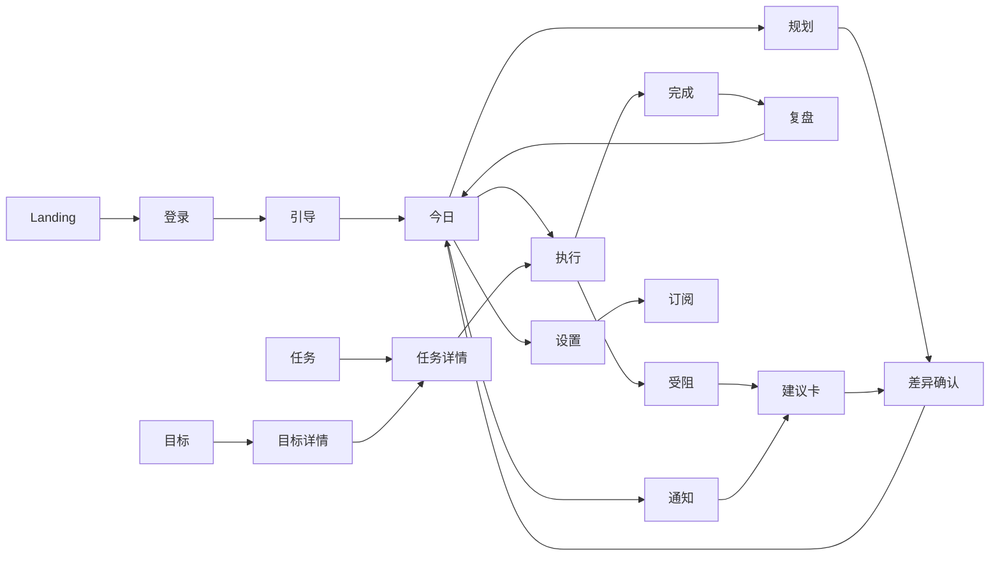

# UI/UX 页面与关键交互

[索引](README.md) · [产品](02-product-market.md)

全量信息架构不等于首版导航。PC 主导航“今日、任务、目标、回顾”，手机底栏“今日、任务、添加、回顾”，更多入口收纳 AI、通知、设置；不把 16 页平铺。

| 页面/路由 | 核心组件与交互 | 跳转/阶段 |
|---|---|---|
| Landing `/` | 一句价值承诺、真实演示、隐私、价格、开始按钮 | →注册；P1 |
| 登录注册 `/login` | 邮箱验证或已支持 OAuth、找回、明确错误，不透露邮箱存在 | →引导/今日；P1 |
| Onboarding `/onboarding` | 时区确认、一个目标/任务、今日可用时间；通知权限后置 | →首个可开始动作；P2 |
| 今日 `/today` | 当前最重要任务、开始按钮、剩余容量、最多3重点、AI情境卡 | →执行/规划/详情；P2 |
| 目标 `/goals` | 活跃/暂停/完成，结果与下一里程碑，快速新增 | →详情；P2 |
| 目标详情 `/goals/:id` | 成功判据、阶段验收、任务列表、偏差，不以任务数等同目标进度 | →任务/拆解预览；P2 |
| 任务 `/tasks` | inbox/未完成/已完成、快速输入、过滤、批量操作 | →详情抽屉；P1 |
| 每日规划 `/plan/:date` | 待安排清单、可用区间、负荷条、时间轴、冲突原因、差异确认 | →今日；P2 |
| 执行 `/focus/:taskId` | 单个下一步、可选计时、暂停/受阻/完成；隐藏统计噪声 | →建议/今日；P2 |
| AI 教练 `/coach` | 情境对话、依据、操作预览、撤销入口；侧栏可打开同一会话 | →确认→原页面；P3 |
| 每日复盘 `/review/:date` | 原计划/执行结果、补记、一个障碍、明日调整 | →明日规划；P2 |
| 分析 `/insights` | 周趋势、估时偏差、有效样本数、无法推断提示 | →对应执行记录；P5 |
| 通知 `/notifications` | 未读、有效建议、过期状态、提醒控制 | →对象/设置；P3 |
| 订阅 `/settings/billing` | Free/Pro权益、周期、AI剩余额度、付款历史、取消/恢复 | →托管支付/门户；P4 |
| 设置 `/settings` | 时区、可用时间、提醒、免打扰、画像开关、导出删除、连接器 | →对应设置页；P1–5 |

首次价值路径目标 ≤3 分钟：用户输入一条任务即可试用，不要求先建完整目标树或连接日历。演示数据必须标注，不能混入用户统计。注册前可展示静态示例；若开放游客操作，迁移和滥用控制额外计入开发范围。

快速添加默认标题一个字段，Enter 提交；自然语言解析日期展示可编辑 chip；含糊“周五之前”必须展示具体日期/时区再保存。预计时长提供15/30/60分钟快捷项并可略过。完成可撤销；删除二次确认；失败保留输入。

AI 卡片显示“一项建议 + 为什么 + 接受/修改/忽略”，默认不自动展开长回复。改计划须列保留/新增/改期/延期及风险，重点任务不能被隐式移除。拒绝后不反复弹出。额度耗尽仍可手工规划、执行和复盘。

手机端使用日程列表代替窄列周视图；操作抽屉不遮住主按钮；触控目标至少44 CSS px；支持键盘增删改期，不让拖拽成为唯一途径。计时在服务器保存起止，浏览器以时间差显示，切后台不依赖 setInterval 精准运行。

全页面必须有空、加载、错误、离线、权限过期、部分失败和冲突状态。WCAG 2.2 AA 为目标：对比度、可见焦点、语义表单、屏幕阅读器状态播报、减少动画、200%缩放；不能只靠红绿区分完成/风险。移动端320px无主流程横向滚动；长中文标题/英文标题皆测试。
