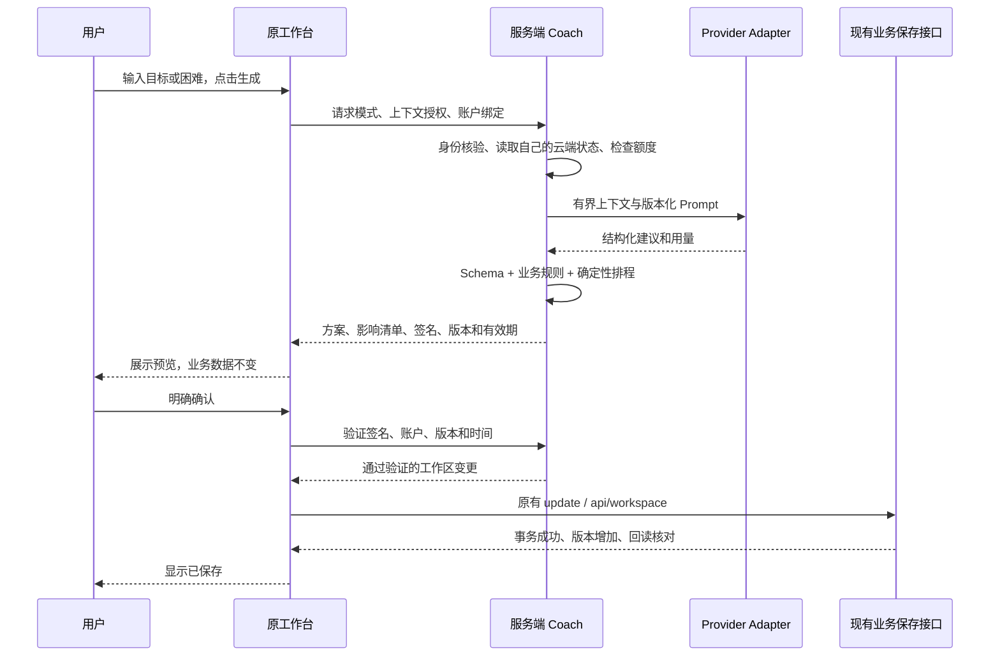

# FlowDay V1.2 AI 执行教练：实施与配置

实施日期：2026-11-19。入口：[文档索引](README.md) · [启动说明](../README.md) · [V1.1 云端接入](15-v1.1-saas-setup.md)。

## 实际交付

保留原有工作台、视觉、任务、目标、日历、排程预览、专注、复盘/涂鸦、数据洞察、认证和云端写入代码，增加四类嵌入式教练能力：

| 能力 | 入口与结果 |
|---|---|
| 目标拆解 | 顶部“AI 拆解新目标”；目标卡片“AI 拆解”；目标任务列表“AI 拆解此目标”。生成澄清问题、阶段、具体任务、估时与建议日期。现有目标只追加行动，不重复创建目标 |
| 执行求助 | 今日原有求助入口；任务详情中的“AI 帮我推进这项任务”。输入不知道如何开始、任务复杂、没有动力、时间不足、落后或意外等情况，得到可能原因和具体下一步 |
| 计划调整 | 今日或日历顶部“AI 调整今日计划”。模型提出改期、轻量步骤和待排任务；程序计算时间、冲突与容量。默认保留已确认时间块，明确勾选后才允许提出重排 |
| 执行画像 | “查看执行画像”。展示真实完成数量、记录专注时长、当前过期计划任务、复盘数量和有限估时对比；数据不足明确说明，不修改业务数据 |

默认使用 **Mock 演示**。界面明确显示“未连接真实 AI”，示例结果也标明由固定规则生成，成本为零。真实 Provider Adapter 已实现，但本次没有提供或使用真实 API Key，没有购买服务、产生付费模型调用或修改远程数据库。

## 立即体验

```bash
npm run dev
```

打开 `http://127.0.0.1:3100`。无 Supabase 配置时，原本的本地工作区继续使用，AI 演示通过本机 Next.js 服务执行。

1. 点击“AI 拆解新目标”，输入“我希望两个月学会 Python 并做一个 Web 项目，目前零基础，每天45分钟”。
2. 点击“生成建议与预览”。查看分析、必要澄清、建议阶段、估时、真实记录边界和预计影响。此时不会创建任何数据。
3. 可以在说明中补充起点、时间或完成标准后重新生成。也可填写“本次最晚安排日期”，程序会拒绝超出该日期的新增任务或改期。
4. 点击“确认执行此方案”才会通过现有保存接口写入。保存确认成功后显示结果，刷新可读回。
5. 对已有任务求助，新增的是独立小行动，原任务不被删除或标记完成。若拆分后想替代原任务，请在既有任务界面人工处理，避免重复安排。
6. 原规则教练在今日求助窗口下方折叠保留，展开“使用原规则教练”即可使用，不依赖外部模型。

Mock 只验证闭环，不能证明自然语言理解和教练建议质量。真实模型配置后仍应以实际结果评估。

## 云端数据库迁移

已经部署 V1.1 开发数据库的，新增执行一次 [202611190002_ai_coach.sql](../supabase/migrations/202611190002_ai_coach.sql)。空白开发数据库则按顺序执行 001、002。不要重跑 001，也不要对生产数据库直接操作。

新增 `ai_requests`，包括：用户、请求摘要、Provider、模型、状态、创建/完成时间、输入/输出 Token、估计美元成本、Prompt 版本和缓存结果。启用 RLS，仅允许用户读取自己的记录；直接写权限撤销，由用户身份范围内的函数处理额度和完成记录。随用户删除级联清理。

`flowday_ai_reserve` 在数据库内锁定用户额度，硬限制每分钟 6 次、每 UTC 自然日 60 次；配置新标签页、换设备或重启 Next.js 不会重置。保留失败请求占用的次数，避免异常重试无限消耗。相同上下文正在处理时拒绝并发重复调用；已完成结果在 5 分钟内可复用。

`flowday_ai_finish` 记录结果和用量。指标用于产品运行观察，不是支付或供应商账单依据。当前所有数据库调用仍使用用户 JWT，不要求 service_role。应用会核对缓存建议的服务端签名，不能通过篡改自己的缓存记录执行未经验证的方案。

本地 Mock 使用有限的进程内缓存与演示会话限额；重启会重置，不能将它作为真实付费调用的配额机制。真实模型必须启用云端身份认证和持久额度。

## 模型配置

配置模板：[.env.example](../.env.example)。API Key 与建议签名密钥均为服务端变量，不加 `NEXT_PUBLIC_`，不提交 Git，不需要发送到聊天中。

本地 Mock 无需模型凭证。**云端模式（包括云端 Mock）** 需额外配置至少 32 个随机字符的 `AI_PROPOSAL_SECRET`，所有部署实例保持一致；可以用密码管理器生成随机字符串。纯本机 Mock 只使用固定的演示签名材料，不具备云端授权用途。

真实模型由项目所有者主动选择供应商和型号，确认允许调用后再配置：

```dotenv
AI_PROVIDER=openai-compatible
AI_ENABLE_PAID_CALLS=true
AI_API_URL=https://YOUR_PROVIDER/COMPLETE_CHAT_COMPLETIONS_ENDPOINT
AI_API_KEY=YOUR_SERVER_SIDE_API_KEY
AI_MODEL=YOUR_JSON_SCHEMA_CAPABLE_MODEL
AI_PROPOSAL_SECRET=YOUR_RANDOM_SECRET_AT_LEAST_32_CHARACTERS
AI_INPUT_USD_PER_MILLION=
AI_OUTPUT_USD_PER_MILLION=
```

使用完整的 HTTPS Chat Completions 端点，而不是只填服务根地址。Adapter 使用 `messages`、`response_format.json_schema`（strict）和 `max_completion_tokens`，要求供应商/模型支持这些字段。实现时核对了 [Chat Completions 官方 API 参考](https://developers.openai.com/api/reference/resources/chat)，研究时间 2026-11-19；“兼容接口”不代表每家供应商都支持同样的结构化输出或参数，需实连验收。未实现自动降级为非结构化输出。

不指定默认付费型号，避免未经选择就采用高成本模型。只有正确配置、登录、主动启用调用并点击生成时才请求模型。没有定时调用、后台循环、模型自动重试或模型工具执行权限。

单价变量按每百万 Token 的美元价格填写。服务返回用量且配置两项单价时计算估计费用；缺少任一信息则显示未知，不能当作零成本。失败/超时可能仍被供应商计费，此时用量可能未知。估计费用不能代替真实账单。

更换服务只需增加或替换 `CoachProvider` 实现，不修改工作台、业务模型和确认流程。配置不完整、接口超时或 Schema 不兼容时显示失败，不假装已切回 Mock 成功。

## 数据与权限流程



模型模块没有数据库客户端、写密钥或工具执行器。模型只能输出白名单字段，不支持删除、任意 API、数据库 SQL、完成任务、解除锁定或修改权限。请求模式也限制操作：画像只读；任务求助只新增建议行动；目标拆解只新建目标/追加行动；改期和排程只能通过计划调整。

云端生成和确认都重新从当前用户数据库读取状态，忽略浏览器伪造的业务上下文。每份建议绑定用户、数据版本、模式、输入条件、原始生成时间及 10 分钟期限，通过 HMAC 签名。更换账户、篡改方案、数据更新或过期后拒绝确认。重复确认最终也会被原有版本事务阻止。

确认接口只做最终验证，**写入仍通过既有业务接口**。若验证后另一设备抢先保存，原有版本事务会拒绝覆盖。保存未成功时不显示完成，不自动重试成另一份方案。

精确时间基于生成时刻确定，确认时重新检查是否已过开始时间；不会在用户未看过的情况下换成新的时段。锁定、已经开始/过去和当前专注任务受到保护。重排已有未来时间块需要显式勾选，并在影响清单中列出；用户不确认就不执行。

## 上下文与执行画像

- 上下文最多 40 项相关任务（说明截取 180 字）、8 个相关目标（说明截取 180 字）、相关时间块、可用时间和程序统计。总上下文以约 14000 字符为界删减任务；用户说明上限 1200 字，输出上限 2500 Token，最多新建 16 项任务。
- 默认不发送复盘文字。只有勾选授权才使用最近 3 篇复盘，每篇最多 200 字，始终不发送涂鸦、邮箱、密码或完整执行事件列表。用户在真实模式生成前可见数据范围提示。
- 程序计算最近 30 天完成量、记录专注分钟、当前过期计划任务及有效估时比较样本。历史事件按 UTC 日期筛选，计划日期使用用户传入的 IANA 时区；筛除未来记录。
- 少于 5 项完成且包含专注记录的样本时，不生成耗时比率。达到样本数也只展示“记录片段 / 样本估时”，不把它当成完整实际耗时、效率或因果关系。
- 现有 MVP 没有完整的任务改期历史，不能声称知道用户拖延次数；也不能仅凭这些记录断言稳定的黄金时段或心理状态。

任务、复盘、用户说明和模型响应均视为不可信数据。系统 Prompt 明确数据不能覆盖权限规则，结构化 Schema 禁止额外工具字段；所有对象引用和改动再经过程序验证，输出以 React 文本显示，不能变成 HTML 或脚本。

建议缓存包含有界用户输入和生成内容，仅限当前账户读取。API 只复用 5 分钟内结果，建议 10 分钟失效；数据库中旧缓存内容在该用户下一次额度预留时清理，**当前没有后台定期清理**。不活跃账户的缓存可能保留更久；若对保留期有严格要求，应在上线配置定期清理任务。Token/成本元数据保留用于运营，删除账户会级联删除记录。本实现不记录原始 Prompt 到控制台或错误日志。

## 当前范围与明确边界

- 阶段按预览分组，创建任务后以说明中的“阶段”标签保留，尚未增加独立阶段实体或任务依赖图。小行动是普通任务，不自动替代原任务。
- 现有任务的 date 仍是计划日期，没有独立的持久化截止日期字段。因此本次支持显式填写“最晚安排日期”并由程序拒绝越界；不会从未知历史推断每项任务的硬截止时间。
- 画像是从真实记录即时推导的基础版本，没有偷偷建立长期心理画像、向量记忆或自动修改偏好。提醒、主动推送和订阅不属于本次范围。
- 现有排程仍以本地日期/墙上分钟为基础；Coach 根据输入时区取得当前日期和时间，但完整跨时区/DST 存储转换仍需后续完善，不能把本次接入当成国际日历系统的完整验收。
- 使用已确认的现有数据库保存接口，单次工作区数据上限仍为 5 MiB；没有新增微服务、Agent 协作、队列或模型 SDK。

## 验证与待实连项目

本次验证：**85 项自动化测试、11 项 Chrome 浏览器测试、类型检查和生产构建通过**。

覆盖：结构化输出拒绝非法字段；禁止删除命令；引用/估时/日期检查；版本/账户/签名/有效期；锁定、专注和过去时间保护；容量和冲突；固定预览时段；显式最晚安排日期；Mock/付费模式开关；缺失成本为未知；默认复盘隔离；云端权威上下文；数据库额度、缓存和 RLS；预览不写入、确认后刷新可读回；为现有目标追加；画像只读；降低负荷并保留锁定时间块。原有目标删除、日历、复盘涂鸦、专注、任务保存及手机布局测试继续通过。

数据库测试在本地 PostgreSQL 引擎执行 001、002 迁移，模拟 Supabase 身份环境。真实模型请求只用接口替身验证参数/响应，浏览器全程使用 Mock。

仍需配置外部凭证才能验证：目标 Supabase 开发项目中的新迁移与真实登录；所选模型是否支持 strict JSON Schema、响应延迟/超时、真实 Token 用量和计费；真实目标拆解质量、不同困难的建议质量、两设备并发时的完整云端确认流程。没有这些凭证时不把本阶段称为“真实 AI 已连接”。

## 关键文件

- [教练 UI](../src/components/ai-coach.tsx)、[原工作台入口](../src/components/workspace.tsx)
- [建议生成 API](../src/app/api/coach/route.ts)、[确认验证 API](../src/app/api/coach/confirm/route.ts)
- [Provider 与 Prompt 版本](../src/modules/coach/provider.ts)、[Schema](../src/modules/coach/schema.ts)
- [上下文和真实统计](../src/modules/coach/context.ts)、[程序编译与排程](../src/modules/coach/proposal.ts)
- [身份边界](../src/modules/coach/server.ts)、[额度和缓存](../src/modules/coach/limits.ts)、[签名](../src/modules/coach/signing.ts)
- [数据库迁移](../supabase/migrations/202611190002_ai_coach.sql)、[配置模板](../.env.example)
- [教练单元测试](../tests/ai-coach.test.ts)、[教练 API 测试](../tests/ai-api.test.ts)、[数据库测试](../tests/cloud-database.test.ts)、[浏览器流程](../e2e/ai-coach.spec.ts)、[计划调整流程](../e2e/ai-plan.spec.ts)
